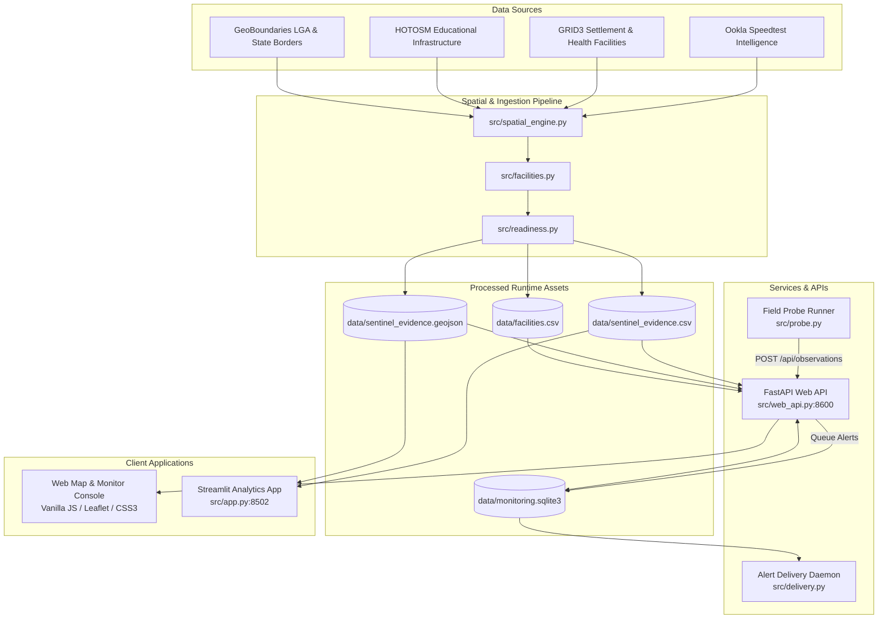

<div align="center">

# 🛰️ INEC-SENTINEL

### Electoral Connectivity Intelligence, BVAS Readiness Scoring & Field Verification Platform

[](https://www.python.org/)
[](https://fastapi.tiangolo.com/)
[](https://streamlit.io/)
[](https://geopandas.org/)
[](tests/)
[](LICENSE)
[](#geospatial-methodology--data-sources)

*Empirical telecom evidence, algorithmic pre-election mission allocation, 49,800+ facility registers, and active incident response for democratic transparency across Nigeria.*

[Features](#key-capabilities) • [Architecture](#system-architecture) • [Quickstart](#quickstart--local-setup) • [GitHub Push Guide](#github-repository-push-guide) • [Vercel & Cloud Deployment](#deployment-guide) • [API Docs](#api-endpoints)

---

</div>

## 📌 Executive Overview

During national elections in Nigeria across **774 Local Government Areas (LGAs)** and over **176,000 Polling Units**, real-time transmission via the **Bimodal Voter Accreditation System (BVAS)** and the **INEC Election Result Viewing Portal (IReV)** relies critically on cellular network availability.

In blind spots and transmission shadows, technical hitches risk public trust, delay accreditation tallying, and compromise transparency.

**INEC-SENTINEL** is an end-to-end geospatial intelligence platform and field telemetry system built to eliminate connectivity surprises *before* and *during* election day:
1. **Pre-Election Audit**: Analyzes crowdsourced mobile network telemetry across all 774 LGAs to identify BVAS transmission vulnerabilities.
2. **Algorithmic Mission Allocation**: Uses constrained optimization to schedule high-priority pre-election field visits under strict budgetary and logistical limits.
3. **Public Infrastructure Register**: Catalogs 49,839 educational and healthcare facilities (potential Registration Area Centres - RACs and polling clusters) with localized historical signal metrics.
4. **Election Day Telemetry & Incident Command**: Provides offline-tolerant synthetic BVAS upload probes, real-time alert triage, and incident response dispatchers with multi-carrier failover visibility.

---

## ⚡ Key Capabilities

### 1. 🗺️ Dual Operational Interfaces
- **Web Command Portal (`/index.html` & `/monitor.html`)**: High-performance, low-latency, zero-dependency browser client with an interactive choropleth map, budget scenario simulator, facility search, incident dashboard, and one-click printable briefing generation.
- **Streamlit Geospatial Explorer (`src/app.py`)**: Rich analytical console featuring PyDeck 3D visualizations, multi-attribute correlation scatterplots, and granular state-by-state filter engines.

### 2. 📊 Empirical BVAS Readiness Classification
Every Nigerian LGA is scored into distinct operational risk tiers:
- 🟢 **Optimal / High Readiness**: Dense cellular coverage, low latency (<80ms), reliable 4G uploads (>5 Mbps).
- 🟡 **Vulnerable / Margin of Risk**: Sporadic coverage or packet loss; recommended for secondary carrier backup or external high-gain antennas.
- 🔴 **High Transmission Risk / Dark Zones**: High probability of transmission timeout; requires offline batch upload protocols or satellite terminal staging.

### 3. 🎯 Budget-Constrained Inspection Planner
- Input total operational budget, cost per team visit, and deployment constraints.
- Algorithmic greedy/knapsack allocation prioritizes visits to LGAs where field reconnaissance will yield the maximum risk reduction.
- Generates downloadable CSV rosters and executive briefing HTML summaries.

### 4. 🏥 49,839 Verified Facility Directory
- Aggregated from authoritative OpenStreetMap (HOTOSM) and GRID3 databases.
- Sub-second search across schools, universities, medical centers, and community halls.
- Instant distance calculation to nearest historical Ookla cell test tiles.

### 5. 📡 Active Monitoring & Synthetic BVAS Probe
- **Field Probe CLI (`src/probe.py`)**: Simulates 64 KiB BVAS payload uploads against API endpoints, testing real-world carrier latency and bandwidth with an offline retry buffer.
- **Incident Lifecycle**: Automated alert triggers when consecutive probe failures occur, supporting acknowledge-investigate-resolve workflows.
- **Multi-channel Notifications (`src/delivery.py`)**: Staged SMS and SMTP dispatch queue with test simulation mode.

---

## 🏗️ System Architecture



---

## 📁 Repository Structure

```
INEC-SENTINEL/
├── .github/                   # CI/CD Workflows & GitHub Actions
├── data/                      # Lightweight runtime databases & GeoJSON
│   ├── facilities.csv         # 49,839 registered facilities (9.4 MB)
│   ├── facilities_audit.json  # Source metadata & schema audit
│   ├── sentinel_evidence.csv  # 774 LGA readiness evidence matrix (108 KB)
│   ├── sentinel_evidence.geojson # Boundary geometry & scores (9.6 MB)
│   └── sentinel_sources.json  # Upstream source tracking
├── docs/                      # Operational guides & team documentation
│   ├── OPERATIONS.md          # Server maintenance, probes & alert delivery
│   ├── REFERENCE.md           # API schemas, data dictionaries & scoring rules
│   ├── TEAM_GUIDE.md          # End-to-end methodology & judge FAQ
│   └── TUTORIAL.md            # 3-minute presentation script & demo walkthrough
├── md/                        # Comprehensive strategic & architecture specs
├── src/                       # Core Python engine
│   ├── app.py                 # Streamlit analytical dashboard
│   ├── build_guide.py         # Printable handbook compiler
│   ├── delivery.py            # SMS & Email notification dispatcher
│   ├── facilities.py          # Facility spatial indexer
│   ├── generate_map.py        # Standalone HTML map generator
│   ├── monitoring.py          # Incident lifecycle & SQLite manager
│   ├── probe.py               # Field verification upload probe
│   ├── readiness.py           # Scoring formulas & visit allocation engine
│   ├── spatial_engine.py      # Spatial join & evidence aggregator
│   └── web_api.py             # FastAPI REST endpoints & static server
├── tests/                     # Automated test suite
│   ├── check_app.py           # Streamlit smoke tests
│   └── test_sentinel.py       # Unit tests for scoring, API & allocation
├── web/                       # Zero-dependency browser web client
│   ├── index.html             # National choropleth & visit planner
│   ├── monitor.html           # Live facility monitor & incident board
│   ├── guide.html             # Printable team operations handbook
│   ├── app.js                 # Map interactions & scenario modeling
│   ├── monitor.js             # Incident polling & facility search
│   └── style.css              # Operational high-contrast dark theme
├── .dockerignore
├── .env.example               # Template for environment variables
├── .gitignore                 # Optimized Git exclusions (clean repository)
├── Dockerfile                 # Production container specification
├── requirements.txt           # Python dependencies
└── README.md                  # Project documentation (this file)
```

---

## 🚀 Quickstart & Local Setup

### 1. Prerequisites
- **Python 3.11 or higher**
- Git installed on your machine
- Modern web browser (Chrome, Edge, Firefox, Safari)

### 2. Installation

Clone this repository and create a virtual environment:

```bash
# Clone the repository
git clone https://github.com/De-Young07/INEC-SENTINEL.git
cd INEC-SENTINEL

# Create and activate virtual environment
python -m venv .venv

# On Windows:
.venv\Scripts\activate

# On Linux/macOS:
source .venv/bin/activate

# Install required dependencies
pip install -r requirements-local.txt
```

### 3. Launching the Applications

#### Option A: Web Command Center (Recommended)
Run the FastAPI service (includes static web portal and REST endpoints):
```bash
python -m uvicorn src.web_api:app --host 127.0.0.1 --port 8600 --reload
```
Open your browser to:
- **Interactive Map & Planning Center**: [http://localhost:8600](http://localhost:8600)
- **Live Facilities & Incident Console**: [http://localhost:8600/monitor.html](http://localhost:8600/monitor.html)
- **Team Handbook & Printable Guide**: [http://localhost:8600/guide.html](http://localhost:8600/guide.html)
- **Interactive API Documentation (Swagger)**: [http://localhost:8600/docs](http://localhost:8600/docs)

*(Windows users can also double-click `Start SENTINEL Web.cmd`)*

#### Option B: Streamlit Analytical Explorer
```bash
streamlit run src/app.py --server.port 8502
```
Access the analytical dashboard at: [http://localhost:8502](http://localhost:8502)

*(Windows users can also double-click `Start SENTINEL.cmd`)*

### 4. Running Verification Tests
Execute the comprehensive test suite:
```bash
python -m unittest discover -s tests
python tests/check_app.py
```

---

## 📡 Active Field Verification & Probing

To test election day telemetry, launch the synthetic probe:

```bash
# Run a single synthetic BVAS upload probe against a facility
python -m src.probe --site OSM-SCH-00042 --carrier MTN

# Continuous probe loop (every 30 seconds)
python -m src.probe --site OSM-SCH-00042 --carrier Airtel --watch --interval 30
```

To run the background notification delivery worker (dispatches SMS/Email upon alert trigger):
```bash
python -m src.delivery --watch
```
*(By default, running in safe preview mode; actual dispatch requires `SENTINEL_SEND=1` and credentials configured in `.env`).*

---

## 🌐 API Endpoints

| Method | Endpoint | Description |
|:-------|:---------|:------------|
| `GET` | `/api/health` | Health check & loaded LGA count |
| `GET` | `/api/evidence` | 774 LGA readiness evidence dataset (JSON) |
| `GET` | `/api/boundaries` | Simplified GeoJSON boundaries for choropleth rendering |
| `POST` | `/api/plan` | Constrained visit allocation algorithm calculation |
| `POST` | `/api/brief` | Generates formatted HTML executive briefing report |
| `GET` | `/api/facilities` | Paginated search across 49,839 facility records |
| `POST` | `/api/observations` | Ingests empirical field probe measurement |
| `GET` | `/api/monitoring` | Real-time incident logs, active alerts & metrics |
| `POST` | `/api/incidents/{id}/acknowledge` | Triages and acknowledges active facility alerts |
| `GET` | `/api/sources` | Metadata audit trail for all ingested datasets |

Full OpenAPI specification is available at `http://localhost:8600/docs`.

---

## 🚢 GitHub Repository Push Guide

To ensure your GitHub repository remains lightweight, professional, and within Git limits, large raw GIS datasets (`.gpkg`, raw `.tif`, `.zip`) and local documents (`.docx`, `.pdf`) have already been configured in `.gitignore`.

Follow these step-by-step commands to push the clean repository to GitHub:

### Step 1: Verify Git Status
Check what files are ready to be staged:
```bash
git status
```
*Notice that large raw files, databases, and Word documents are automatically omitted.*

### Step 2: Stage and Commit the Clean Codebase
```bash
git add .
git commit -m "feat: complete INEC-SENTINEL platform with geospatial analytics, planning engine and monitoring system"
```

### Step 3: Set Default Branch and Push to GitHub
```bash
# Ensure branch is main
git branch -M main

# Verify remote (already configured to your GitHub repository)
git remote -v

# Push code to GitHub
git push -u origin main
```

*(If you ever need to force overwrite an empty initial commit on a fresh repo: `git push -u origin main --force`)*

---

## ☁️ Deployment Guide

### Option 1: Deploying to Vercel

> [!IMPORTANT]
> **Understanding the Architecture on Vercel:**
> - The **Web Frontend** (`web/index.html`, `web/monitor.html`, `web/app.js`, `web/style.css`) is a fast, static web application that deploys seamlessly to Vercel's Edge Network.
> - The **FastAPI Backend** (`src/web_api.py`) utilizes C-extension geospatial packages (`geopandas`, `pyogrio`, `scipy`) and persistent SQLite (`monitoring.sqlite3`). Vercel serverless functions have a 250 MB unzipped limit, strict cold-start timeouts, and ephemeral filesystems (where SQLite changes reset between requests).

#### How Best to Deploy with Vercel:

#### Recommended Strategy: Frontend on Vercel + Backend on Cloud
1. **Deploy Backend to Render / Railway / Fly.io** (using the included `Dockerfile`):
   - One-click deploy the repository on [Render.com](https://render.com) or [Railway.app](https://railway.app).
   - Both natively support Docker, persistent disks for SQLite, and heavy GIS packages.
   - You receive a live backend URL, e.g., `https://sentinel-api.onrender.com`.

2. **Deploy Frontend on Vercel**:
   - In `web/app.js` and `web/monitor.js`, point the API calls to your cloud backend URL:
     ```javascript
     const API_BASE = window.location.hostname === 'localhost' 
       ? '' 
       : 'https://sentinel-api.onrender.com';
     ```
   - In Vercel:
     - Import your GitHub repo `De-Young07/INEC-SENTINEL`.
     - Set **Root Directory** to `web` (or leave root and use the `vercel.json` below).
     - Deploy! Your web application will be live globally on Vercel's CDN.

#### Monolithic Static Deployment on Vercel (`vercel.json`):
If deploying the web interface directly from the repository root on Vercel, create a `vercel.json`:

```json
{
  "version": 2,
  "public": false,
  "cleanUrls": true,
  "rewrites": [
    { "source": "/", "destination": "/web/index.html" },
    { "source": "/monitor", "destination": "/web/monitor.html" },
    { "source": "/guide", "destination": "/web/guide.html" },
    { "source": "/(.*)", "destination": "/web/$1" }
  ]
}
```

---

### Option 2: Docker Container Deployment (All-in-One Production)

Deploy anywhere Docker is supported (Render, AWS ECS, GCP Cloud Run, DigitalOcean, Azure):

```bash
# Build the production Docker image
docker build -t inec-sentinel:latest .

# Run container exposing port 8600
docker run -d -p 8600:8600 --name sentinel-live inec-sentinel:latest
```

Access the complete running system at `http://localhost:8600`.

---

### Option 3: Streamlit Community Cloud
To share the interactive 3D geospatial dashboard with judges or stakeholders:
1. Go to [share.streamlit.io](https://share.streamlit.io).
2. Connect your GitHub account and select `De-Young07/INEC-SENTINEL`.
3. Set **Main file path** to `src/app.py`.
4. Click **Deploy!**

---

## 📐 Geospatial Methodology & Data Sources

| Provider / Dataset | Role in INEC-SENTINEL |
|:-------------------|:----------------------|
| **Ookla Speedtest Intelligence** | Crowdsourced empirical mobile metrics (Q3/Q4 test tile aggregations, average upload/download Mbps, ping latency, sample counts). |
| **GRID3 Nigeria** | High-resolution operational settlements, population density distributions, and primary healthcare facility points. |
| **Humanitarian OpenStreetMap (HOTOSM)** | Educational institutions (primary, secondary, universities) serving as potential Registration Area Centres (RACs). |
| **GeoBoundaries** | Standardized administrative boundaries (ADM2 / LGA level) for Nigeria's 774 councils across all 36 States and FCT. |

---

## 🔒 Security, Integrity & Boundaries

- **Local Pilot Scope**: This implementation was developed as an evidence pilot for hackathon demonstration. Production rollout into official electoral workflows requires integration with authorized INEC enterprise identity (SSO), encrypted device certificates for BVAS terminals, and managed spatial databases (PostGIS/CockroachDB).
- **Authentication**: Field ingestion endpoints enforce constant-time secret comparison via the `SENTINEL_INGEST_TOKEN` environment variable.
- **Data Privacy**: No voter identification, voter card numbers, or personalized ballot data are captured or processed. Metrics reflect infrastructure connectivity and institutional facility coordinates only.

---

## 👥 Project Team & Hackathon Submission

Developed for the **DSN Bootcamp Hackathon** by **Quadri Adebisi** and Team.

- **GitHub**: [@De-Young07](https://github.com/De-Young07)
- **Documentation**: Comprehensive technical references are available in the [docs/](docs/) folder.

---

<div align="center">
  <sub>Built with precision for Nigerian electoral resilience and digital equity.</sub>
</div>